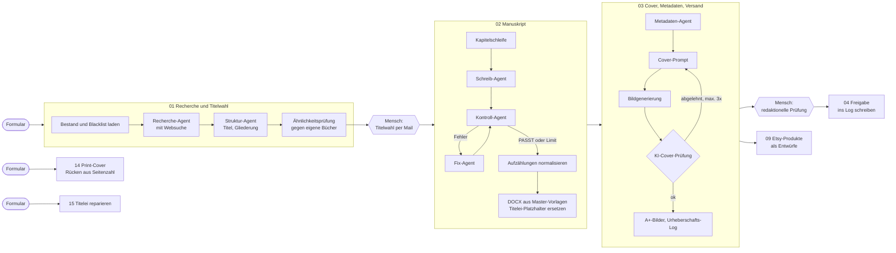

# Buchproduktion mit n8n

Automatisierte Produktionskette für deutschsprachige Ratgeber auf Amazon KDP, inklusive Cover, Metadaten, Druckvorlagen und daraus abgeleiteter digitaler Produkte für Etsy. Gebaut und betrieben nebenberuflich auf einer self-hosted n8n-Instanz.

**Interaktive Demo:** [flonoe77.github.io/buchproduktion-n8n](https://flonoe77.github.io/buchproduktion-n8n/) zeigt alle Workflows als klickbaren Graphen, inklusive Code und Prompts jedes Nodes.

Stack: n8n (self-hosted, Docker), Claude API (Anthropic), Tavily, Recraft, CloudConvert, Gotenberg, Google Sheets/Drive/Docs/Gmail, Etsy API v3.

## Kennzahlen

| | |
|---|---|
| Workflows der Buchkette | 7, zusammen 200 Nodes |
| KI-Schritte pro Buch | 16 Agent- bzw. LLM-Nodes (Recherche, Struktur, Schreiben, Prüfen, Korrigieren, Metadaten, Cover-Prompt, Cover-Prüfung, Etsy) |
| Durchlaufzeit Manuskript | ca. 47 Minuten für 10 Kapitel |
| Manuelle Eingriffe im letzten vollständigen Testlauf | 0 nach der Titelwahl |
| Menschliche Freigaben pro Buch | 2: Titelwahl und redaktionelle Prüfung |
| Variable Kosten pro Buch | ca. 4 bis 5 USD API-Kosten, inklusive Etsy-Produkte |
| Nodes mit automatischem Retry | 58 |
| Ausführungen auf der Instanz | über 1.800 seit März 2026 (alle Workflows) |
| Ergebnis bisher | 5 Bücher produziert, 3 veröffentlicht |

Ehrlich dazu: Technisch läuft die Kette, kommerziell ist das Projekt noch nicht erfolgreich. Die ersten Titel haben kaum Erlös gebracht. Gerade wird geklärt, ob das Problem Sichtbarkeit oder Produkt ist, bevor die Produktion hochgefahren wird.

## Architektur



Jeder Workflow meldet Abbrüche an den System-Workflow `fehler-alarm`, abgebrochene Läufe von 02 und 03 lassen sich über `execution-fortsetzen` am fehlgeschlagenen Node wieder aufnehmen.

Gemeinsamer Zustand liegt in einem Google Sheet (Buch-Master), die Dateien pro Buch in einem eigenen Drive-Ordner. Jede Stufe liest ihre Eingaben neu aus dem Sheet, statt sie nur durchgereicht zu bekommen. Dadurch lässt sich jede Stufe einzeln für ein bestimmtes Buch neu starten.

## Was schiefging

### 1. Ein Workflow mit 95 Nodes, und jeder Fehler kostete doppelt

Die erste Version war ein einziger Workflow. Brach er bei Node 80 ab, startete ein Retry wieder bei Node 1: Recherche, alle Kapitel und alle Bilder wurden erneut erzeugt und erneut bezahlt, und ein zweiter Druckauftrag bei CloudConvert war möglich.

Lösung: Aufteilung in Stufen, die über das Sheet gekoppelt sind. Dazu kamen zwei System-Workflows: [`execution-fortsetzen`](workflows/system/execution-fortsetzen.json) setzt eine abgebrochene Ausführung über die n8n-API genau am fehlgeschlagenen Node fort, und [`fehler-alarm`](workflows/system/fehler-alarm.json) schickt bei jedem Abbruch eine Mail mit Node, Fehlermeldung und dem ausdrücklichen Hinweis, nicht blind neu zu starten.

### 2. Der Prüfkreis lief, kostete Geld und hatte keine Wirkung

Jedes Kapitel geht durch einen Kontroll-Agenten, bei Fehlern korrigiert ein Fix-Agent. Wochenlang schien das zu funktionieren. Dann fiel auf, dass der Node danach immer den Text des **Schreib**-Agenten weitergab, nie den korrigierten. Jede Korrektur wurde bezahlt und verworfen.

Nach der Reparatur zeigte sich das zweite Problem: Der Kreis hatte keine Abbruchbedingung. Solange der Prüfer einen Fehler meldete, hätten beide Agenten endlos gegeneinander laufen können. Vorher war das nur nicht aufgefallen, weil der Prüfer jede Runde denselben unkorrigierten Text sah.

Lösung: Der [`Korrektur-Zaehler`](workflows/02-manuskript-produktion.json) begrenzt die Runden pro Kapitel, der Prüf-Prompt wurde auf drei objektiv prüfbare Fehlerarten eingeengt, und die `Kontroll-Statistik` protokolliert pro Buch, wie oft und warum korrigiert wurde.

### 3. Alles grün, Ergebnis trotzdem falsch

Zwei vollständige Testläufe endeten grün. Drei Tage später fiel beim Öffnen der Dateien auf: Aufzählungen waren zu Fließtext verschmolzen, im Klappentext brach ein Satz mitten im Zitat um, und in der Titelei wurde der Autorname nur an 2 von 7 Stellen ersetzt.

Die Ursache war an allen drei Stellen derselbe Denkfehler: Ein Zeichen wurde als Struktur behandelt, obwohl es keine ist. Ein `•` ist für Markdown kein Listenpunkt, ein schließendes Anführungszeichen ist kein Satzende, und Word verteilt `{{BUCH_AUTOR}}` intern auf mehrere Textabschnitte, sodass ein einfaches Suchen und Ersetzen den Platzhalter nicht findet.

Lösung: Normalisierung der Aufzählungen vor der Konvertierung, eine Satzerkennung, die Anführungszeichen berücksichtigt, und eine Ersetzung, die Word-Absätze als Ganzes liest ([`15-titelei-platzhalter`](workflows/15-titelei-platzhalter.json) zeigt das in kompakter Form). Aufgefallen ist es nur, weil die erzeugten Dateien nach jedem Lauf von Hand geprüft werden. Ein grüner Durchlauf sagt nur, dass nichts abgestürzt ist.

### 4. Ein Fehler, der still geblieben wäre

Beim Vorbereiten paralleler Starts fiel auf, dass die Buch-ID beim Start des Workflows berechnet wurde, also bevor der Mensch den Titel wählt. Zwischen Start und Schreiben liegen oft Stunden. Drei versetzte Starts hätten dieselbe ID gezogen und die Daten dreier Bücher ohne Fehlermeldung vermischt.

Lösung: Der Node `Buch-IDs neu lesen` in [`01-recherche-und-titelwahl`](workflows/01-recherche-und-titelwahl.json) berechnet die ID unmittelbar vor dem Schreiben. Der Fehler wurde vor dem ersten Parallellauf gefunden und ist nie eingetreten.

## Weitere Designentscheidungen

- **Drafts statt Live:** Etsy-Listings werden ausschließlich als Entwurf angelegt. Veröffentlichen ist ein bewusster manueller Schritt.
- **Ähnlichkeitsprüfung:** Neue Buchkonzepte werden gegen den eigenen Bestand verglichen. Ab einem harten Schwellwert stoppt die Produktion, darunter wird nur markiert.
- **Cover-Kontrolle mit Notausgang:** Ein zweites Modell prüft jedes generierte Cover. Nach drei abgelehnten Versuchen wird das letzte als `FEHLER_Cover_…` abgelegt und der Lauf geht weiter, statt endlos Bilder zu bezahlen.
- **Urheberschafts-Log:** Pro Buch entsteht automatisch ein Dokument, das die menschlichen Beiträge festhält. Die redaktionelle Prüfung wird per Formular eingetragen, nicht per Häkchen vorausgefüllt.
- **Print-Cover nach KDP-Formel:** Rückenbreite aus Seitenzahl und Papierstärke, Beschnitt, Barcode-Freifläche, gerendert als PDF über Gotenberg.

## Inhalt

```
workflows/
  01-recherche-und-titelwahl.json
  02-manuskript-produktion.json
  03-cover-metadaten-versand.json
  04-redaktionelle-freigabe.json
  09-etsy-produkte-und-listings.json
  14-print-cover.json
  15-titelei-platzhalter.json
  system/
    fehler-alarm.json
    execution-fortsetzen.json
    testlauf-starter.json
    tavily-suche-sub.json
docs/          Quelltext der Demo-Seite (GitHub Pages)
SETUP.md       Import und Platzhalter
```

Die Exporte sind bereinigt: Workflow-, Datei- und Credential-IDs, Server-URL, Mailadressen und Autorennamen sind durch Platzhalter ersetzt. Prompts und Code sind unverändert. Wie man die Workflows importiert, steht in [SETUP.md](SETUP.md).
